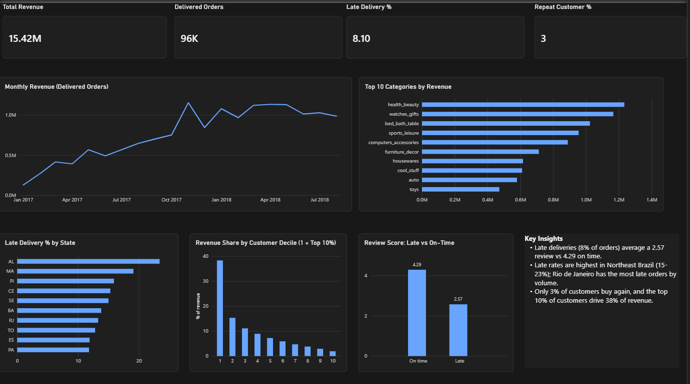

# Olist E-Commerce Sales & Customer Analysis (PostgreSQL + Power BI)

## Business problem
Acting as an analyst at an e-commerce marketplace, I analyzed where revenue comes from, how customers behave, and what hurts customer satisfaction, using SQL for analysis and Power BI for reporting.

## Dataset
[Brazilian E-Commerce Public Dataset by Olist](https://www.kaggle.com/datasets/olistbr/brazilian-ecommerce) (Kaggle): about 99K orders (2016-2018) across 9 relational tables (orders, customers, items, payments, reviews, products, sellers, geolocation, category translation).

## Tools
PostgreSQL, DBeaver, Power BI Desktop

## Dashboard

## Key findings
1. **Revenue growth plateaued.** Monthly revenue grew from about $128K (Jan 2017) to about $1.1M (early 2018), peaking in Nov 2017 ($1.15M, +53.6% MoM, likely Black Friday), then flattened around $1.0-1.1M through Aug 2018.
2. **Late deliveries hurt satisfaction.** 8% of delivered orders arrived late and averaged a 2.57 review score vs 4.29 for on-time orders (late orders took about 31 days vs 10).
3. **Late rates vary by region.** Northeast Brazil states had the highest late rates (AL 23.4%, MA 19.1%, PI 15.9%, CE 15.3%, SE 15.0%). Rio de Janeiro (13.3% late) had the most late orders by volume (about 1,600).
4. **Retention is weak.** Only 3.0% of customers (2,801 of 93,358) placed a second order.
5. **Spend is concentrated.** The top 10% of customers generated 38.3% of revenue, and the top 20% generated 53.6%.
6. **Revenue is spread across categories.** Health & beauty (9.3%), watches & gifts (8.8%) and bed/bath/table (7.7%) lead; the top 10 categories make up about 62% of product revenue.
7. **A few sellers drag down ratings.** Seller scorecards (late rate + review score) flagged sellers with 30%+ late rates and ratings below 3.4.

## Recommendations
- Add regional fulfillment or renegotiate carrier SLAs for Rio de Janeiro, the largest source of late orders.
- Set more realistic delivery estimates for Northeast states, where late rates run 15-23%.
- Launch retention efforts (repeat-purchase incentives) since 97% of customers buy only once.
- Put sellers with a late rate above 20% and an average review below 3.5 on a performance plan, and review product quality for sellers with low ratings but acceptable delivery.

## SQL skills demonstrated
Multi-table joins, CTEs, window functions (LAG, NTILE, RANK, SUM OVER), conditional aggregation (FILTER, CASE), date functions, HAVING, and review deduplication.

## Queries
| File | Purpose |
|---|---|
| 00_schema.sql | Table definitions |
| 01_monthly_revenue_growth.sql | Monthly revenue and MoM growth |
| 02_top_categories.sql | Top categories and share of revenue |
| 03_repeat_customers.sql | Repeat customer rate |
| 04_spend_segmentation.sql | Customer spend deciles |
| 05_delivery_vs_reviews.sql | Late vs on-time delivery and review scores |
| 06_delivery_by_state.sql | Delivery performance by state |
| 07_worst_sellers.sql | Seller scorecard |
| 08_Kpis.sql | Dashboard KPI cards |

## Notes and limitations
- Revenue in the monthly analysis and KPI cards uses payment value (includes freight); the category analysis uses item price only.
- Only delivered orders are included. Late 2016 data is sparse, so growth analysis starts in Jan 2017, and the dataset ends in Aug 2018.
- `customer_unique_id` is used to identify repeat customers, because `customer_id` is generated per order.
- Delivery by state excludes states with fewer than 100 orders. Findings show association, not causation.

## How to reproduce
1. Download the dataset from Kaggle and load the 9 CSVs into PostgreSQL using `00_schema.sql`.
2. Run the queries in order.
3. Open `olist_dashboard.pbix` in Power BI Desktop, or view `dashboard.png`.
